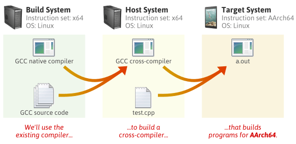

# 1. Introduction to Cross-Compilation

## What is cross-compilation?

> **Cross-compilation** is the process of compiling software on one system to produce executable code for a different target system.

Example we want to build a program on our laptop and run it on Raspberry Pi. Consider our environment:

| Property | Development machine | Target device |
|---|---|---|
| Hardware | Desktop or laptop | Raspberry Pi 4 |
| Operating system | Ubuntu | Raspberry Pi OS |
| CPU architecture | x86-64 | AArch64 |
| Purpose | Compile and build software | Execute the resulting program |

**Native compilation**

> Native compilation means compiling software for the system on which the resulting program is intended to run

Example:

```bash
gcc hello.c -o hello
```

The resulting executable will normally target the native x86-64 Linux environment.

**Cross-compilation**

> Cross-compilation is the process of compiling for a system different from the one on which the build is being performed.

Example:

```bash
aarch64-linux-gnu-gcc hello.c -o hello_arm64
```

The compiler runs on Ubuntu, but the resulting executable targets AArch64 Linux.

## How does cross-compilation work?



# 2. Three main choices for the C library

## 2.1 glibc

> `glibc` stands for GNU C Library.

It is widely used by general-purpose Linux distributions, including Debian and Ubuntu.

Typical characteristics:

- Broad compatibility with software built for mainstream GNU/Linux environments.

- Extensive support for C and POSIX interfaces.

- A mature ecosystem.

- Compatibility requirements that depend on the glibc version and other runtime dependencies.

For example, a dynamically linked program might require GLIBC_2.xx symbols. If the target system provides an older glibc version, the program may fail to start.

> **Best use case**: General-purpose Linux applications where compatibility with an existing glibc-based operating system matters.

## 2.2 musl

> `musl` is a C library designed around simplicity, standards conformance, and a relatively compact implementation.

Typical characteristics:

- Suitable for many lightweight Linux environments.

- Used by Alpine Linux.

- Provides an alternative to glibc.

- May require adjustments when porting software that depends on glibc-specific behavior or interfaces.

A program built for musl should not be assumed to run on a system that only provides glibc, or vice versa.

> **Best use case**: Embedded systems, minimal Linux distributions, and environments where you control the runtime and want to use musl deliberately.

## 2.3 uClibc

> `uClibc` is a C library aimed at embedded Linux systems.

Typical characteristics:

- Designed with embedded use cases in mind.

- Can be configured to suit particular system requirements.

- May be useful in constrained environments.

- Requires checking application compatibility and the availability of maintained toolchain components.

> **Best use case**: Specialized embedded Linux systems where the developer controls the software stack and has a specific reason to select uClibc.

**Comparison**

| Criterion | glibc | musl | uClibc-ng |
|---|---|---|---|
| Typical environment | General-purpose Linux | Lightweight Linux | Embedded Linux |
| Compatibility with mainstream glibc applications | Native fit for compatible versions | May require porting | May require porting |
| Suitable for embedded devices | Yes | Yes | Yes |
| Runtime compatibility across different libc implementations | Not guaranteed | Not guaranteed | Not guaranteed |
| Recommended for our initial Pi 4 exercise | **Yes** | Not initially | Not initially |

# 3. Ready-to-use cross-compiling toolchains vs. building a custom toolchain

**What is a prebuilt toolchain?**

> A prebuilt toolchain is a collection of tools that someone has already compiled and packaged for you.
