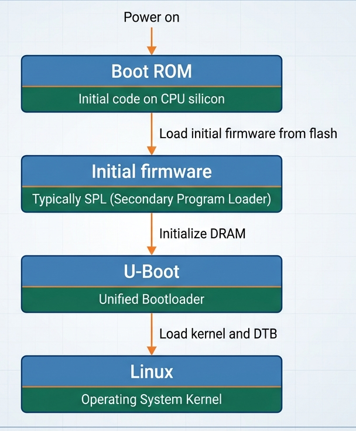

# Boot ROM

## What is Boot ROM?

> Boot ROM is code stored inside the processor's System-on-Chip (SoC).
>> It is normally programmed by the silicon manufacturer and is ***not intended to be replaced by the user***.

The Boot ROM performs enough initialization to locate and load the next boot stage.

**Typical responsibilities include:**

- Identifying available boot sources.

- Reading boot configuration pins or registers.
- Loading initial firmware from a supported device.
- Performing basic image authentication when secure boot is enabled.
- Transferring execution to the next stage.

**Depending on the SoC, supported boot sources might include:**

- SD card

- eMMC
- SPI flash
- NAND flash
- USB recovery mode
- Other manufacturer-specific interfaces

## Why do we need Boot ROM?

> Immediately after reset, the processor cannot assume that DRAM or other peripherals are initialized.
>
> Boot ROM provides the first executable code needed to start the boot process.

Example:



**Can we modify Boot ROM?**

> Normally, ***no***. We generally configure or replace later boot stages rather than modifying the Boot ROM itself. (U-Boot, the Linux kernel and the root filesystem)

# First-stage bootloader

> Some ARM platforms require an intermediate boot stage before U-Boot can run.

We may encounter names such as:

- `SPL`: Secondary Program Loader, a common U-Boot component.

- `TPL`: Tertiary Program Loader, used on some platforms.
- `TF-A`: Trusted Firmware-A, which implements secure-world and other low-level firmware functionality on supported ARM systems.
- Vendor-specific initialization firmware.

## Why is an intermediate stage necessary?**

> If a system with limited resources is started up without an intermediate boot stage, Full U-Boot may be too large to load into available on-chip memory.
>
>> The solution on some boards is to execute a small initial program from limited on-chip memory.

That program initializes DRAM and loads the larger bootloader as show above picture.

# U-Boot

> U-Boot (full name is **Das U-Boot**) is a widely used open-source bootloader for embedded systems.
>
>> U-Boot runs before the Linux kernel and prepares the system to boot an operating system.

its source code is available at:

- Official project: https://docs.u-boot.org/

- Source repository: https://source.denx.de/u-boot/u-boot

**What does U-Boot do?**

Its responsibilities commonly include:

1. Initializing or completing initialization of hardware needed for booting.

2. Providing an interactive command-line interface.
3. Reading kernel images and Device Tree Blobs from storage.
4. Downloading images over a network.
5. Setting the kernel command line.
6. Passing the DTB to Linux.
7. Transferring execution to the kernel.

## U-Boot command-line interface

After connecting a serial terminal and interrupting the automatic boot countdown, you might see:

```bash
U-Boot 2025.x

=> 
```

Some useful commands are:

| Command | Purpose |
|---|---|
| `help` | List available commands |
| `version` | Display the U-Boot version |
| `bdinfo` | Display board-related information |
| `printenv` | Display environment variables |
| `setenv` | Create or modify environment variables |
| `saveenv` | Save environment variables when supported |
| `mmc list` | List available MMC devices |
| `mmc info` | Display information about an MMC device |
| `fatls` | List files on a supported FAT filesystem |
| `fatload` | Load a file from FAT into memory |
| `dhcp` | Obtain network configuration using DHCP, if supported |
| `ping` | Test network reachability, if supported |
| `tftpboot` | Download a file using TFTP |
| `booti` | Boot a supported Linux Image on 64-bit ARM |
| `bootm` | Boot supported image formats, including relevant legacy and FIT images |

## U-Boot environment variables

> U-Boot stores configuration as environment variables.

The environment can be stored persistently in a configured storage location, or it can exist only in memory. Persistence depends on the board configuration.

**Important**: `setenv` usually changes the in-memory environment. `saveenv` requests persistent storage, but it works only when persistent environment support is configured.

## U-Boot boot scripts

> The `bootscript` is an script that is automatically executed when the boot loader starts, and before
the OS auto boot process.

The bootscript allows the user to execute a set of predefined U-Boot commands automatically before proceeding with normal OS boot.

## How does U-Boot boot Linux?
