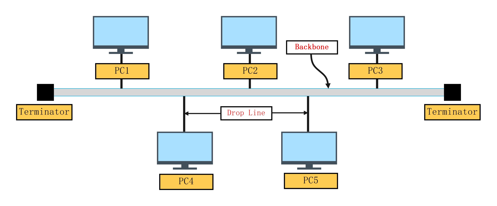
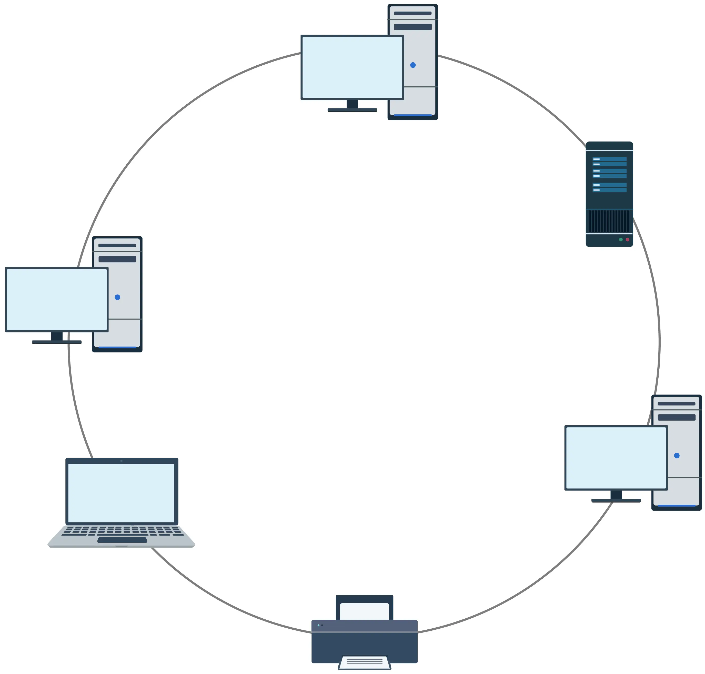
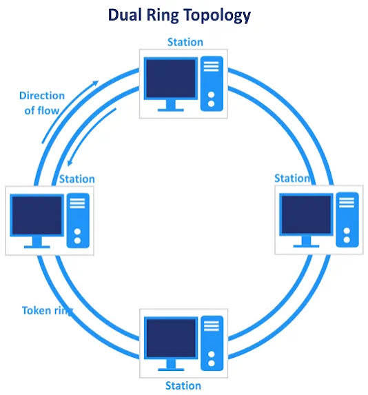
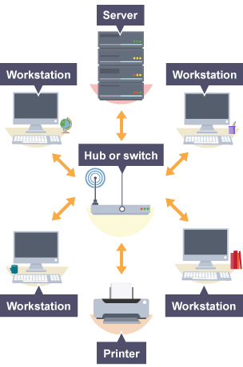
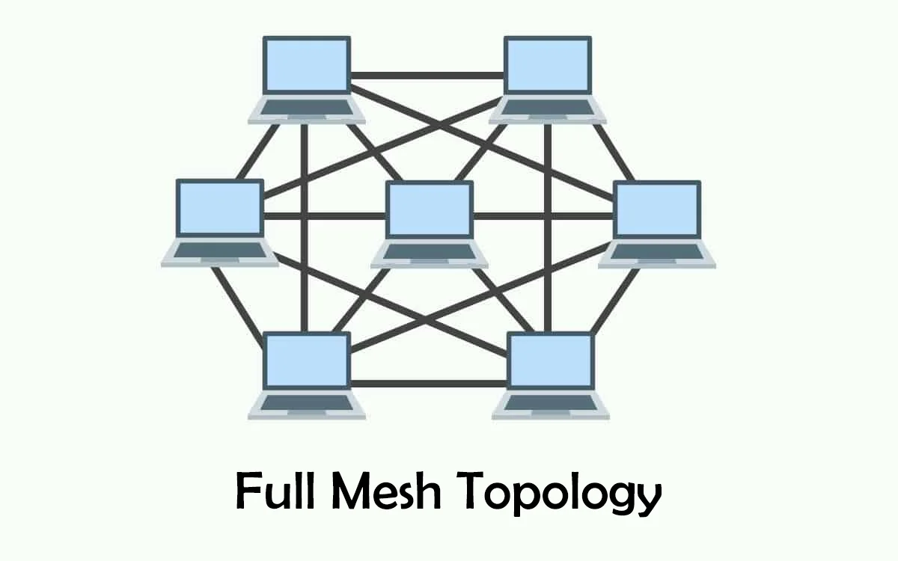
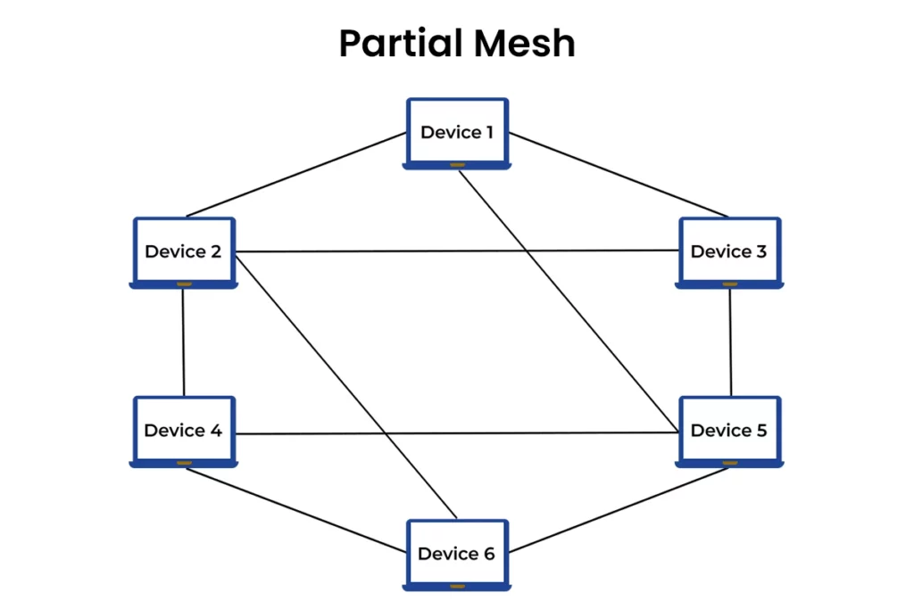
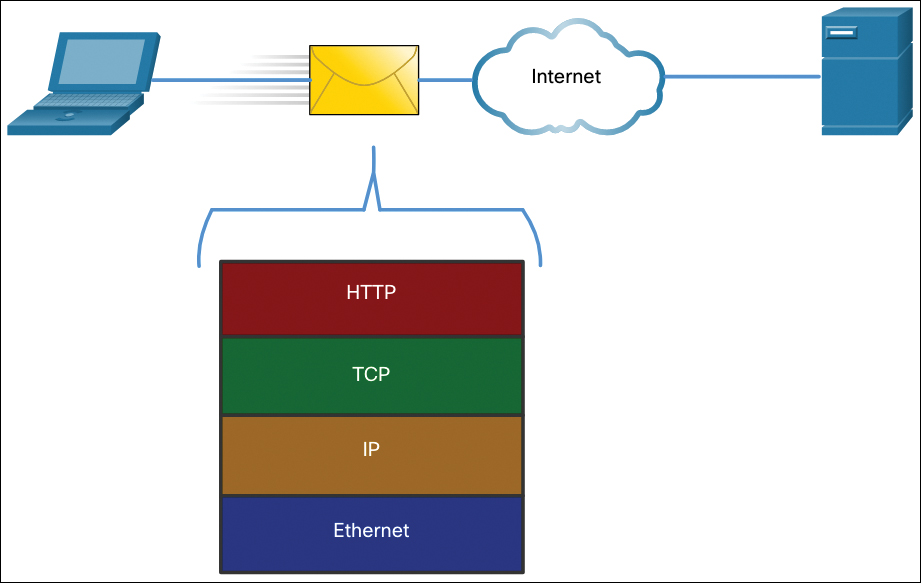
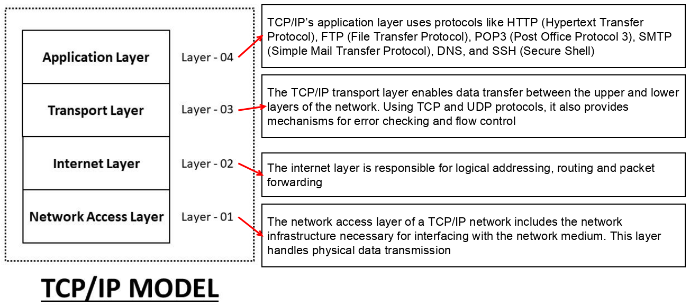
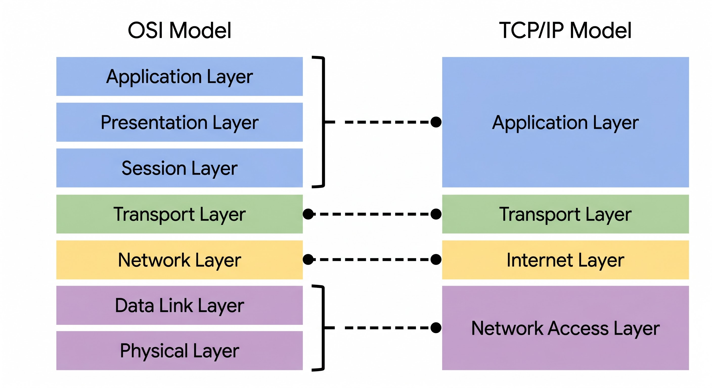

# What is computer networking?

> ***A computer network is a system of interconnected computing devices—ranging from traditional to cloud-based environments—that communicate and share resources with one another.***
# Key networking components and devices

- **IP address**: An IP address is a unique number assigned to every network device in an Internet Protocol (IP) network. Each IP address identifies the device’s host network and its location on the network. When one device sends data to another, the data includes a “header” that consists of the IP addresses of both the sending and receiving devices.

- **Nodes**: A node is a network connection point that can receive, send, create or store data. It’s essentially any network device (for example, a computer, printer, modem, bridge or switch) that can recognize, process and transmit information to another network node. Each node requires some form of identification (such as an IP or MAC address) to receive access to the network.

- **Routers**: A router is a physical or virtual device that sends data “packets” between networks. Routers analyze the data within packets to determine the optimal transmission path and use sophisticated routing algorithms to forward data packets until they reach their intended destination node.

- **Switches**: A switch is a device that connects network devices and manages node-to-node communication across a network, ensuring that data packets reach their intended destinations. Unlike routers, which send information between networks, switches send information between nodes within a network.

Therefore, “switching” refers to how data is transferred between devices on a network. Networks rely on three main types of switching:

- - **Circuit switching** establishes a dedicated data communication path between nodes in a network so that no other traffic can traverse the same path. Circuit switching ensures that full bandwidth is available during every transmission.

- - **Message switching** sends whole messages from the source node to the destination node, with the message traveling from switch to switch until it reaches the destination.

- - **Packet switching** involves breaking down data into independent components to make data transmission less demanding of network resources. With packet switching, packets, instead of entire data streams, travel through the network to their end destination.

|Criteria|Circuit Switching|Message Switching|Packet Switching|
|---|---|---|---|
|Transmission Path|Fixed & Dedicated. A separate, exclusive channel is established for the duration of the call/data transmission.|Not fixed. Data passes through intermediate nodes (switches) without occupying the entire path.|Not fixed. Individual packets independently find the most optimal path to their destination.|
|Bandwidth|100% Guaranteed. Full, continuous bandwidth is provided to both endpoints and is not shared.|Shared. Bandwidth is shared with other messages along the same route.|Dynamically Shared. Bandwidth is optimized, allowing multiple devices to transmit data simultaneously.|
|Data Handling|A continuous stream of data is transmitted from end to end without interruption.|The entire message is transmitted as a whole; it is stored at each switch before being forwarded (Store-and-Forward).|Data is broken down into independent, numbered packets.|
|System Latency|Latency occurs only during the initial call setup. Once connected, latency is zero.|Highest Latency. Intermediate nodes must receive and store the entire message before forwarding it.|Low Latency. Small packets are processed very quickly at network nodes.|
|Real-world Examples|Traditional Public Switched Telephone Network (PSTN).|Early email systems (SMTP), legacy messaging architectures.|Modern Internet (TCP/IP), VoIP, web browsing.|

- **Ports**: A port indicates a specific connection between network devices, with each port identified by a unique number. If an IP address is analogous to a hotel address, then ports are the suites and room numbers. Computers use port numbers to determine which application, service or process should receive which messages.

- **Gateways**: Gateways are hardware devices that facilitate communication between two different networks. Routers, firewalls and other gateway devices use rate converters, protocol translators and other technologies to facilitate internetwork communication between otherwise incompatible devices.

# Types of computer networks 

## Network types by geographical area

- - Personal area network (PAN)
- - Local area network (LAN)
- - Metropolitan area network (MAN)
- - Wide area network (WAN)

## Network types by transmission medium

- Wired networks
- Wireless networks

## Network types by communication type

- **Multipoint networks**: In a multipoint network, multiple devices share channel capacity and network links.

- **Point-to-point networks**: Network devices establish a direct node-to-node link to transmit data.

- **Broadcast networks**: On broadcast networks, several interested “parties” (devices) can receive one-way transmissions from a single sending device. Television stations and radio stations rely on broadcast networks.

- **Virtual private networks (VPNs)**: A VPN is a secure, point-to-point connection between two network endpoints.

# Network architectures

Computer network architecture establishes the theoretical framework for a computer network, encompassing design principles and communication protocols.

The primary types of network architectures include:

- Peer-to-peer (P2P) architectures

- Client-server architectures

- Hybrid architectures

## Peer-to-peer (P2P) architectures

> In a P2P architecture, two or more computers are connected as “peers,” meaning they have equal power and privileges on the network.  
>
> A P2P network doesn’t require a central server for coordination. Instead, each computer on the network acts as both a *client* and a *server*.

## Client-server architectures

> In a client-server network, a central server (or group of servers) manages resources and delivers services to client devices on the network.
>
> Clients in this architecture don’t share their resources and interact only through the server.

## Hybrid architectures

> Hybrid architectures incorporate elements of both the P2P and client-server models.

# Network topology

> Whereas ***architecture*** represents the theoretical framework of a network, ***topology*** refers to the practical implementation of that framework.

Common network topologies include:

- **Bus** network topology

- **Ring** network topology

- **Star** network topology

- **Mesh** network topology

## Bus topology

> In a bus topology, every network node is directly connected to a main cable.

> This topology is cost-effective and easy to implement, but it has limitations, such as a single point of failure; if the backbone fails, the entire network goes down. Bus networks are also less secure due to the shared backbone. Additionally, as more nodes share a central cable, the risk of data collisions increases, reducing network efficiency and potentially causing network slowdowns.

## Ring topology

> In a ring topology, nodes are connected in a loop, so each device has exactly two neighbors.
>
> Adjacent pairs are connected directly, and nonadjacent pairs are connected indirectly through intermediary nodes.

> Data flows in one direction around the ring, though dual-ring systems can send data in both directions. These networks are generally cheap to install and expand and data flows quickly within the network.
>
> The main vulnerability of ring networks is that a failure of a single node can bring down the whole network.
>> Dual-ring networks are used to protect against this type of failure.  
>> A dual-ring network features two concentric rings instead of one.

> - The Primary Ring used to transmit data during normal operation.
> - The Secondary Ring functions as a backup path (typically running in the opposite direction to the Primary Ring).
> - Failover: In the event of a failure in a cable or network node on the Primary Ring, the system automatically connects the primary and secondary rings at the point of failure to form a new, single ring, ensure that the data flow remains uninterrupted.

## Star topology

> Star network topologies feature a single, central hub through which all nodes are indirectly connected.
>
> If a single node fails, the rest of the network is unaffected, as long as the central hub is operational.

## Mesh topology

> Mesh topologies are more complex, defined by overlapping connections between nodes. There are two types of mesh networks, ***full mesh*** and ***partial mesh***.

- In a ***full mesh topology***, every network node connects to every other network node, providing the highest level of network resilience.

- In a ***partial mesh topology***, only some network nodes connect, typically those nodes that exchange data most frequently.

**Summary table**

| Topology | Structure | Advantages | Disadvantages |
|---|---|---|---|
| Bus | Devices share a single communication line | Simple, low cost | A backbone failure affects the entire network |
| Ring | Devices are connected in a ring | Structured data flow | Difficult to handle node or link failures in a single-ring setup |
| Star | Devices connect through a central device | Easy to expand and manage | The central device is a single point of failure |
| Mesh | Nodes have multiple interconnections | High reliability, multiple redundant paths | High cost and complexity |

# Network communication protocols (TCP/IP)

> Communication between server and client requires interaction between many protocols. The interaction between the different protocols on a device can be illustrated as a protocol stack.

> The separation of functions enables each layer in the stack to operate independently of others.

# Compare OSI and TCP/IP

