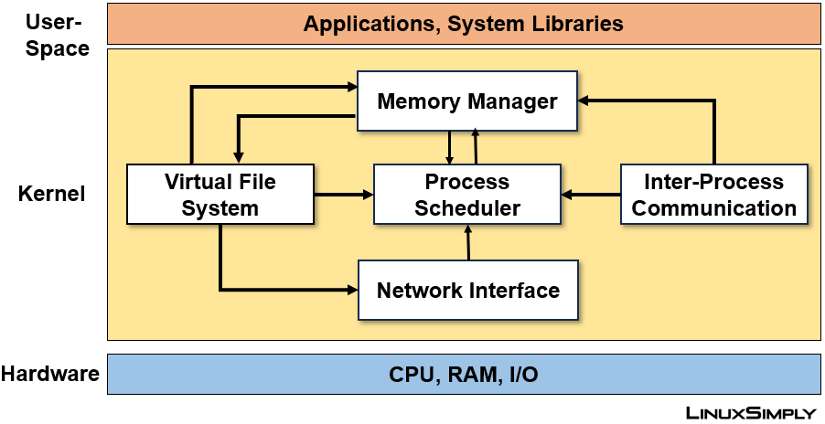

# 1. Operating System: what it is and why it is needed ?

Suppose you run two programs:

```bash
./server
./client
```

Both require CPU and RAM.

Without an OS management mechanism, each program would have to manage its own CPU usage and resources. Furthermore, there would be no reliable protection mechanism to prevent one program from corrupting another's memory space.

In Linux, the kernel provides mechanisms to address these issues:

- **Process management**: Manages processes and CPU scheduling.
- **Memory management**: Manages physical memory, virtual memory, and address mapping.
- **File system**: Provides an interface for accessing files and directories.
- **Networking**: Provides mechanisms for data transmission and reception over a network.
- **Device drivers**: Provide interfaces for supported hardware devices.
- **Protection**: Enforces protection mechanisms and resource access controls.

> Note that these functions are not necessarily performed by a single component. The kernel is organized into multiple subsystems that work together.

## 1.1 Three core roles of an operating system

### Abstraction

Abstraction enables programs to utilize resources through a unified interface without requiring an understanding of the full hardware details.

Example:

```c
int fd = open("/tmp/data.txt", O_RDONLY);
char buf[1024];

ssize_t n = read(fd, buf, sizeof(buf));
```

The program does not need to perform tasks such as:

- Directly controlling the SSD.
- Identifying the physical blocks containing data.
- Controlling the storage controller.
- Managing the kernel's data cache.
- Handling all details of device communication.

Instead, the program utilizes the file descriptor interface and relevant system calls. The kernel coordinates the necessary subsystems to fulfill the request.

### Resource Management

A computer has finite resources:

- The CPU has a finite number of cores.
- RAM has a finite capacity.
- Storage devices have finite speed and processing capabilities.
- Network bandwidth is limited.

The kernel must manage the use of these resources.

The Linux scheduler determines which process executes on the CPU based on scheduling policies and the system state.

Regarding RAM, the kernel manages physical memory, supports virtual memory, handles page faults, and coordinates with memory allocation mechanisms.

For I/O devices, the kernel provides interfaces and mechanisms that allow authorized processes to access and use the devices.

> The kernel not only provides access to resources but also determines how resources are allocated, protected, and reclaimed.

### Protection and Isolation

Typically, each process has its own virtual address space.

Process A cannot arbitrarily read from or write to Process B's private memory simply by using a virtual address within its own address space.

The CPU and MMU (Memory Management Unit), configured and managed by the kernel, enforce memory access control mechanisms.

If a process attempts to access a memory region it is not authorized to access, the CPU may trigger an exception. Linux typically handles this situation by sending a SIGSEGV signal to the offending process.

## 1.2 Why shouldn't a program access hardware directly?

First, it is necessary to distinguish between two issues:

1. **Access rights**: Is the program permitted to perform this operation?
2. **Execution mechanism**: If permitted, which interface does the program use to request the operation?

On a standard Linux system, applications cannot arbitrarily perform hardware operations that require privileges. Instead, they request services through interfaces provided by the operating system.

There are three main reasons for this.

**Reason 1: System protection**  
Suppose an application could arbitrarily write to device control registers or modify memory configurations.

A bug in the application could corrupt the device state or destabilize the entire system.

Therefore, the CPU provides privilege levels and access control mechanisms. The kernel performs the necessary privileged operations, while standard applications run in user mode.

**Reason 2: Resource sharing**  
Suppose two applications want to use the network card simultaneously.

If each application controlled the hardware directly without a coordination mechanism, conflicts could arise regarding queue management, buffering, and device state.

Linux provides a networking subsystem, socket API, and device management mechanisms so that multiple applications can use network resources in an organized manner.

**Reason 3: Portability and abstraction**  
An application using the socket API does not need to write the code to control specific network cards itself.

The same program can run on various Linux systems with different hardware, provided the systems offer the necessary interfaces and functions.

# 2. Linux Architecture

**Is the Linux kernel the entire Linux operating system?**

In common usage, the term "Linux" can refer to either the kernel or a complete Linux system. Technically, it is necessary to distinguish between the two concepts:

- Linux kernel: The core component that manages resources, enforces security mechanisms, and provides interfaces for programs.
- Linux distribution: A complete system that combines the Linux kernel with libraries, system programs, administration tools, package managers, and other components.

For example, Ubuntu is a Linux distribution; it utilizes the Linux kernel but includes various other components to form a complete operating environment.

## 2.1 Key components

| Component | Role |
|---|---|
| Bootloader | Boots the system and loads the kernel. |
| Linux kernel | Manages resources, provides system calls, and coordinates system operations. |
| System libraries | Provide APIs for applications to access system services; e.g., glibc. |
| System utilities | Tools for system administration and operation. |
| Shell | Interactive interface that accepts commands and launches programs. |
| Applications | Programs serving users or the system. |

# 3. User space and Kernel space



# 4. Linux Kernel Components

| Subsystem | Responsibility | Examples studied |
|---|---|---|
| Process management | Managing processes, threads, and scheduling | `fork()`, `execve()`, `waitpid()` |
| Memory management | Managing physical and virtual memory | `mmap()`, page fault, shared memory |
| VFS | Providing a unified file interface | `open()`, `read()`, `write()` |
| Networking | Managing sockets and network protocols | `socket()`, `bind()`, `recv()` |
| IPC | Supporting inter-process communication | Pipe, FIFO, POSIX message queue |
| Device drivers | Connecting devices to the kernel | GPIO, UART, I²C, SPI |
| Scheduler | Deciding which thread executes on the CPU | Switching between execution threads |