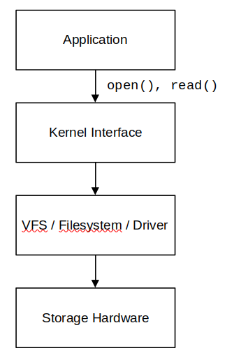

# 1. Operating System (OS)

**what it is and why it is needed ?**

Suppose you run two programs:

```bash
./server
./client
```

Both require CPU and RAM.

Without an OS management mechanism, each program would have to manage its own CPU usage and resources. Furthermore, there would be no reliable protection mechanism to prevent one program from corrupting another's memory space.

An operating system provides mechanisms for resource management and system protection, and enables programs to utilize hardware through standardized interfaces.

We need to distinguish between the operating system as a complete system and the kernel as its core component.

In Linux, the kernel provides mechanisms to address these issues:

- **Process management**: Manages processes and CPU scheduling.
- **Memory management**: Manages physical memory, virtual memory, and address mapping.
- **File system**: Provides an interface for accessing files and directories.
- **Networking**: Provides mechanisms for data transmission and reception over a network.
- **Device drivers**: Provide interfaces for supported hardware devices.
- **Protection**: Enforces protection mechanisms and resource access controls.

> Note that these functions are not necessarily performed by a single component. The kernel is organized into multiple subsystems that work together.

## 1.1 Three core roles of an operating system

### Abstraction - Hardware abstraction

Suppose a computer has a storage device. The actual hardware could be an HDD, a SATA SSD, or an NVMe SSD. Each type of device communicates differently.

If every application had to manage each device type itself, software development would be extremely complex.

> Abstraction enables programs to utilize resources through a unified interface without requiring an understanding of the full hardware details.
>
> Linux provides a unified file interface.

Example:

```c
int fd = open("/tmp/data.txt", O_RDONLY);
char buf[1024];

ssize_t n = read(fd, buf, sizeof(buf));
```

The program does not need to perform tasks such as:

- Directly controlling the SSD.
- Identifying the physical blocks containing data.
- Controlling the storage controller.
- Managing the kernel's data cache.
- Handling all details of device communication.

Instead, the program utilizes the file descriptor interface and relevant system calls. The kernel coordinates the necessary subsystems to fulfill the request.



The diagram above represents a generalized model. The **VFS** handles the file interface, the **filesystem** manages data organization, while the **block I/O layers** and **drivers** handle the path to the storage device.

### Resource Management

A computer has limited resources:

- The CPU has a finite number of cores.
- RAM has a finite capacity.
- Storage devices have finite speed and processing capabilities.
- Network bandwidth is limited.

Without an appropriate management mechanism, programs may compete for resources and affect one another. The OS addresses this issue using mechanisms such as:

- The Linux scheduler determines which process executes on the CPU based on scheduling policies and the system state.

- Regarding RAM, the kernel manages physical memory, supports virtual memory, handles page faults, and coordinates with memory allocation mechanisms.

- For I/O devices, the kernel provides interfaces and mechanisms that allow authorized processes to access and use the devices.

> The kernel not only provides access to resources but also determines how resources are allocated, protected, and reclaimed.

### Protection and Isolation

Typically, each process has its own virtual address space.

Process A cannot arbitrarily read from or write to Process B's private memory simply by using a virtual address within its own address space.

The CPU and MMU (Memory Management Unit), configured and managed by the kernel, enforce memory access control mechanisms.

If a process attempts to access a memory region it is not authorized to access, the CPU may trigger an exception. Linux typically handles this situation by sending a SIGSEGV signal to the offending process.

## 1.2 Why shouldn't a program access hardware directly?

First, it is necessary to distinguish between two issues:

1. **Access rights**: Is the program permitted to perform this operation?
2. **Execution mechanism**: If permitted, which interface does the program use to request the operation?

On a standard Linux system, applications cannot arbitrarily perform hardware operations that require privileges. Instead, they request services through interfaces provided by the operating system.

There are three main reasons for this.

**Reason 1: System protection**  
Suppose an application could arbitrarily write to device control registers or modify memory configurations.

A bug in the application could corrupt the device state or destabilize the entire system.

Therefore, the CPU provides privilege levels and access control mechanisms. The kernel performs the necessary privileged operations, while standard applications run in user mode.

**Reason 2: Resource sharing**  
Suppose two applications want to use the network card simultaneously.

If each application controlled the hardware directly without a coordination mechanism, conflicts could arise regarding queue management, buffering, and device state.

Linux provides a networking subsystem, socket API, and device management mechanisms so that multiple applications can use network resources in an organized manner.

**Reason 3: Portability and abstraction**  
An application using the socket API does not need to write the code to control specific network cards itself.

The same program can run on various Linux systems with different hardware, provided the systems offer the necessary interfaces and functions.

# 2. Linux Architecture

**Is the Linux kernel the entire Linux operating system?**

In common usage, the term "Linux" can refer to either the kernel or a complete Linux system. Technically, it is necessary to distinguish between the two concepts:

- **Linux kernel**: The core component that manages resources, enforces security mechanisms, and provides interfaces for programs.

- **Linux distribution**: A complete system that combines the Linux kernel with libraries, system programs, administration tools, package managers, and other components.

For example, ***Ubuntu*** is a *Linux distribution*; it utilizes the Linux kernel but includes various other components to form a complete operating environment.

## 2.1 Key components

| Component | Role |
|---|---|
| Bootloader | Boots the system and loads the kernel. |
| Linux kernel | Manages resources, provides system calls, and coordinates system operations. |
| System libraries | Provide APIs for applications to access system services; e.g., glibc. |
| System utilities | Tools for system administration and operation. |
| Shell | Interactive interface that accepts commands and launches programs. |
| Applications | Programs serving users or the system. |

# 3. User space and Kernel space

**User space** is the environment where ordinary applications run. Programs have their own address spaces and are not permitted to arbitrarily access kernel resources or hardware.

**Kernel space** is the execution environment for the kernel. The kernel possesses privileged access to manage memory, processes, devices, and system resources.


**Compare User Space and Kernel Space:**

| Criterion | User space | Kernel space |
|---|---|---|
| Purpose | Running applications | Resource management and system service provision |
| CPU privilege | Typically user mode | Kernel mode |
| Memory | Process address space | Kernel address space and kernel-managed regions |
| System call | Sends service requests | Receives and processes requests |
| Hardware access | Typically via authorized interfaces | Can use kernel mechanisms to manage hardware |
| Execution errors | Usually affects the process | Can affect the entire system |
| Examples | TCP server, shell, C applications | Scheduler, filesystem code, kernel modules |

# 4. Linux Kernel Architecture

> The Linux kernel is the core of the Linux operating system, responsible for managing hardware resources and providing system services to programs running in user space.

For example, a C program can perform:

```c
int fd = open("/var/log/app.log", O_RDONLY);
char buf[1024];
ssize_t n = read(fd, buf, sizeof(buf));
close(fd);
```

The program does not need to directly control the SSD controller, manage page tables, schedule the CPU, or implement a file access permission system.

Instead, it requests the kernel to perform these tasks via system interfaces such as `open()`, `read()`, and `close()`.

A distinction needs to be made here between two concepts:

- **System call**: An interface for a user-space program to request a service from the kernel.

- **Kernel subsystem**: An internal kernel component responsible for performing a specific set of functions.

**The five main subsystems and the role of each component:**

| Subsystem | Responsibility | Examples studied |
|---|---|---|
| Process management | Managing processes, threads, and scheduling | `fork()`, `execve()`, `waitpid()` |
| Memory management | Managing physical and virtual memory | `mmap()`, page fault, shared memory |
| VFS / File System | Providing a unified file interface | `open()`, `read()`, `write()` |
| Networking | Managing sockets and network protocols | `socket()`, `bind()`, `recv()` |
| Device drivers | Connecting devices to the kernel | GPIO, UART, I²C, SPI |

These five subsystems do not operate separately. They coordinate to provide complete services for the application.

# 5. Linux Kernel Module

A Linux Kernel Module (LKM) is a piece of code that can be loaded into or unloaded from the Linux kernel while the system is running, provided the kernel and system configuration allow it.

**Why does Linux need kernel modules?**

Imagine if Linux did not support loadable modules. When you wanted to add a driver for a new device, you might have to recompile the kernel and reboot the system to use the new kernel version.

**Key benefits:**

- **Flexibility**: Functions can be added to the kernel while the system is running.
- **Resource efficiency**: Not all drivers need to be loaded at startup.
- **Ease of maintenance:** Components can be developed and updated independently of the rest of the kernel.
- **Broad device support**: Drivers can be loaded when a device is detected or when the system requires them.

## Built-in kernel code vs. Loadable module

Linux supports two ways of incorporating functionality into the kernel.

| Criterion | Built-in | Loadable module |
|---|---|---|
| Integration method | Linked into the kernel image during compilation | Loaded into the kernel when needed |
| Common file(s) | `vmlinux` or compressed kernel image | `.ko` file |
| Can be loaded separately after boot? | No, because the code is already in the kernel | Yes |
| Can be removed separately while the system is running? | No | Yes, if safety conditions are met |
| Initialization | Via the kernel's initialization mechanism | Via the module initialization mechanism |
| Example | A kernel function configured as `=y` | A driver configured as `=m` |

## Linux Driver

**Concept**

> A device driver is a software component responsible for controlling or managing a specific type of device, providing appropriate operations for use by the kernel and other components.

Drivers can work with:

- **Physical devices**: network cards, disk drives, keyboards, GPUs.
- **Virtual devices** or **devices** without a corresponding physical hardware component.
- **Hardware controllers** and **buses** such as PCI, USB, I²C, and SPI.

# Summary


