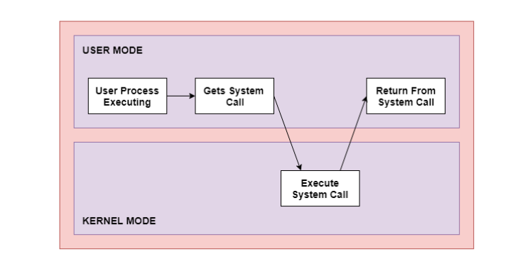

# Overview of user-kernel communication interfaces: System Call, IOCTL, proc file system, Netlink Socket

## Userspace and Kernel Space

> **Userspace** is the environment in which ordinary programs run.

These programs can perform calculations, process data, manage their own memory, and invoke system interfaces.

However, a standard program cannot arbitrarily access the kernel's internal memory or directly manipulate every hardware device.

> **Kernelspace** manages the core resources and functions of the system.

Examples:

- **Process Management**: Manages processes and CPU scheduling.
- **Memory Management**: Manages physical memory, virtual memory, and memory mapping.
- **Filesystem**: Provides mechanisms for accessing files and directories.
- **Networking** Subsystem: Handles network protocols, sockets, and routing.
- **Device Drivers**: Provide mechanisms for interacting with hardware devices.

**Why is it necessary to separate the two spaces?**

Suppose you are writing a C program to control an LED connected to a GPIO pin on a Raspberry Pi.

```c
led_on();
```

However, the CPU does not inherently understand that this function is intended to change the state of a GPIO pin.

The application must use an interface provided by the kernel or a driver to request that this operation be performed.

> Userspace make a request; the kernel executes or coordinates the operation via the provided interfaces.

**How does userspace communicate with the kernel?**

> Linux provides various interfaces for userspace programs to exchange data or request that the kernel perform tasks. And ưe focus on four interfaces:
>
> - System Call
> - IOCTL
> - procfs
> - Netlink Socket

# 1. System Call Interface in Linux

> A system call is a mechanism that allows a userspace program to request that the Linux kernel perform an operation supported by the system.

**Mechanism of System Call Operation**

Example we run:

```bash
cat /etc/hostname
```

The `cat` program needs to read data from the file `/etc/hostname`:

```text
1. cat calls open()
│
▼
2. Kernel processes the file-opening request
│
▼
3. cat receives a file descriptor
│
▼
4. cat calls read()
│
▼
5. Kernel returns data to userspace
│
▼
6. cat displays the data
```

When using read(), an application does not need to know whether the filesystem retrieves the data from a cache or from a physical storage device.

The kernel handles these details through the appropriate components.



**Compare System call and Regular Function Call**

| Criteria | Regular Function Call | System Call |
|---|---|---|
| Purpose | Execute a function | Ask the kernel to perform the | operation
| Switch to kernel | Not necessarily | Yes |
| Example | `add(10, 20)` | `read(0, &c, 1)` |
| Implementation costs | Usually lower | Usually higher due to transition to kernel |

## 1.1 What is syscall()?

> Linux provides the `syscall()` library function, which allows a C program to invoke a system call by its number.

Prototype:

```c
#define _GNU_SOURCE
#include <unistd.h>
#include <sys/syscall.h>

long syscall(long number, ...);
```

Where:

- `number`: the system call number.
- Subsequent parameters: the arguments required by the corresponding system call.

Retrun:

- 0: Success
- -1: fail

Example:

```c
long pid = syscall(SYS_getpid);
```

Here:

- `SYS_getpid` is a macro containing the system call number for `getpid` on the corresponding architecture.
- `syscall()` is a C library function.
- The system call processed by the kernel is `getpid`.

Example code get pid of process using `syscall()` and `getpid()`:

```c
int main(void)
{
    long pid = syscall(SYS_getpid);

    if (pid == -1)
    {
        fprintf(stderr, "syscall failed: %s\n", strerror(errno));
        return 1;
    }

    printf("PID from syscall(): %ld\n", pid);
    printf("PID from getpid():  %d\n", getpid());

    return 0;
}
```

```text
PID from syscall(): 35532
PID from getpid():  35532
```

# 2. IOCTL — Communication between Userspace and Device Driver

## 2.1 What is IOCTL?

> The `ioctl()` is the most common way for applications to interface with device drivers. IOCTL provides an interface for sending specific control commands to an object represented by a file descriptor.

**How does IOCTL work?**

```text
                 USERSPACE
        ┌─────────────────────────┐
        │     C Application      │
        │                         │
        │ fd = open("/dev/...")   │
        │                         │
        │ ioctl(fd, CMD, &data)   │
        └────────────┬────────────┘
                     │
                     ▼
        ┌─────────────────────────┐
        │  ioctl() system call    │
        └────────────┬────────────┘
                     │
                     ▼
                 KERNEL SPACE
        ┌─────────────────────────┐
        │    VFS / Driver Core    │
        │            │            │
        │            ▼            │
        │      Device Driver      │
        │            │            │
        │            ▼            │
        │   process command       │
        └────────────┬────────────┘
                     │
                     ▼
        ┌─────────────────────────┐
        │   Hardware / Device     │
        └─────────────────────────┘
```

The process unfolds as follows:

1. The application opens the device and obtains a file descriptor.

2. The application calls ioctl() using that file descriptor.

3. The kernel identifies the object to be processed based on the file descriptor.

4. The driver handles the command, provided it supports the requested operation.

5. The result is returned to the application.

> **NOTE:**  
> The kernel does not inherently understand the meaning of every IOCTL command. The driver must implement the logic for handling these commands, and applications must use the specific interface provided by the driver.

Prototype:

```c
#include <sys/ioctl.h>

int ioctl(int fd, unsigned long request, ...);  /* glibc, BSD */
int ioctl(int fd, int request, ...);            /* musl, other UNIX */
```

| Parameter | Meaning |
|---|---|
| `fd` | File descriptor of the device or object to be controlled |
| `request` | IOCTL command code |
| Third parameter | Value or data pointer, depending on the command |
| Return value | Command dependent; Normally `-1` gives error |

Return:

- Usually, on success zero is returned.  A few ioctl() operations use the return value as an output parameter and return a nonnegative value on success.

- On error, -1 is returned.

Example:

```c
int fd = open("/dev/gpio_demo", O_RDWR);

ioctl(fd, GPIO_GET_STATE, &state);
```

Meaning:

- `fd`: identifies the opened device.
- `GPIO_GET_STATE`: a request to query the state.
- `&state`: the address of a userspace variable used to receive the data.

> **NOTE:**
>
> - If the driver correctly implements this command, it can retrieve the device state and return the data to the application.
>
> - If the driver does not support the command, the call will typically fail with an error such as ENOTTY; however, the exact behavior depends on the recipient and the specific implementation. As below:
>
> - - `GPIO_GET_STATE: Inappropriate ioctl for device`

## 2.2 Four macros that define IOCTL commands

```c
_IO()   /* the command does not pass a data object via a pointer */
_IOR()  /* Userspace wants to receive data from the kernel */
_IOW()  /* userspace sends data to the kernel */
_IOWR() /* data exchange in both directions */
```

Example:

```c
ioctl(fd, _IO('G', 1));
ioctl(fd, _IOW('G', 2, int), &data);
ioctl(fd, _IOR('G', 3, int), &recv);
```

# 3. Procfs

## What is Procfs?

> The proc file system is a pseudo-file system that provides an interface for accessing the data structures of the operating system kernel.

It is commonly mounted at `/proc`. Unlike standard filesystems such as `/home` or `/etc`, entries in `/proc` primarily provide information generated by the kernel when a program accesses them.

Example of retrieving information about how long the system has been running:

```bash
cat /proc/uptime
```

**How does procfs work?**

Still using the example above and we have a workflow:

```text
Userspace
+----------------------+
| cat /proc/uptime     |
+----------------------+
           |
           | open()
           | read()
           v
+----------------------+
| Linux System Calls   |
+----------------------+
           |
           v
+----------------------+
| Kernel VFS           |
| Virtual File System  |
+----------------------+
           |
           v
+----------------------+
| Procfs               |
| Callback read data   |
+----------------------+
           |
           v
     return data
           |
           v
         cat
           |
           v
    show in terminal
```

## Distinguishing between Procfs and IOCTL

| Criteria | Procfs | IOCTL |
|---|---|---|
| Interface | Path-based (e.g., `/proc/gpio_demo_rw`) | Invoking `ioctl()` on a file descriptor |
| Reading data | Typically via `cat` or `read()` | Sending a command code to retrieve status |
| Writing data | Typically via `echo` or `write()` | Sending a command code along with parameters |
| Format | Usually text-based | Typically command codes and structured data |
| Best use case | Status information, simple text-based interfaces | Structured device commands, diverse operations |

# 4. Netlink Socket

## What is Netlink Socket?

> Netlink is a socket-based communication mechanism between userspace and the Linux kernel.

Example we run:

```bash
ip link show
```

Linux needs to provide information about network interfaces, such as:

- Interface name: eth0, wlan0.
- Interface status: UP or DOWN.
- MAC address.
- Relevant network attributes.

**Workflow**

```text
             USERSPACE
    +-------------------------+
    |  Application            |
    |  ip / Custom C Program  |
    +-------------------------+
                |
                | socket(AF_NETLINK, ...)
                | sendmsg()
                | recvmsg()
                v
    +-------------------------+
    |    Linux Kernel         |
    |    Netlink Subsystem    |
    +-------------------------+
                |
                v
    +-------------------------+
    |    Rtnetlink Handler    |
    |    Network Subsystem    |
    +-------------------------+
                |
                v
    +-------------------------+
    | Network Interfaces      |
    | Routing / Link State    |
    +-------------------------+
```

The application does not directly read the kernel's internal memory. Instead, it sends messages in a format specified by the Netlink interface; the kernel then receives and processes those messages.

**Distinguishing Netlink from the interfaces previously studied**

| Interface | Communication Method | Usage Example |
|---|---|---|
| System call | Invoking kernel services via system calls | `getpid()`, `read()` |
| IOCTL | Sending command codes via file descriptors | Device control |
| Procfs | Reading/writing entries in `/proc` | Accessing kernel information |
| Netlink | Sending/receiving messages via sockets | Querying network interfaces, routes, and IP addresses |

**Netlink has two notable advantages in networking:**

> - Messages are structured, consisting of a header, a message type, flags, and the corresponding data.
> - Event notification support: applications can register to receive network events, rather than continuously polling the kernel to check for changes. For instance, Rtnetlink supports notifications regarding the addition, removal, or status changes of network interfaces.

## Key components of Netlink

### AF_NETLINK

This is the socket address used to create a Netlink socket:

```c
socket(AF_NETLINK, SOCK_RAW, NETLINK_ROUTE);
```

### NETLINK_ROUTE

Linux has multiple Netlink families that serve various purposes.

| Family | Purpose |
|---|---|
| `NETLINK_ROUTE` | Managing interface information, IP addresses, and routing tables |
| `NETLINK_SOCK_DIAG` | Querying socket information |
| `NETLINK_GENERIC` | Generic Netlink mechanism for various subsystems |

### struct nlmsghdr

Each Netlink message typically begins with a structured header:

```c
struct nlmsghdr {
    __u32 nlmsg_len;    /* total length of the message */
    __u16 nlmsg_type;   /* type of the message */
    __u16 nlmsg_flags;  /* flags that control the request */
    __u32 nlmsg_seq;    /* sequence number used to match a request with its response */
    __u32 nlmsg_pid;    /* port ID of the source Netlink socket; in basic usage, this is typically associated with the process PID */
};
```